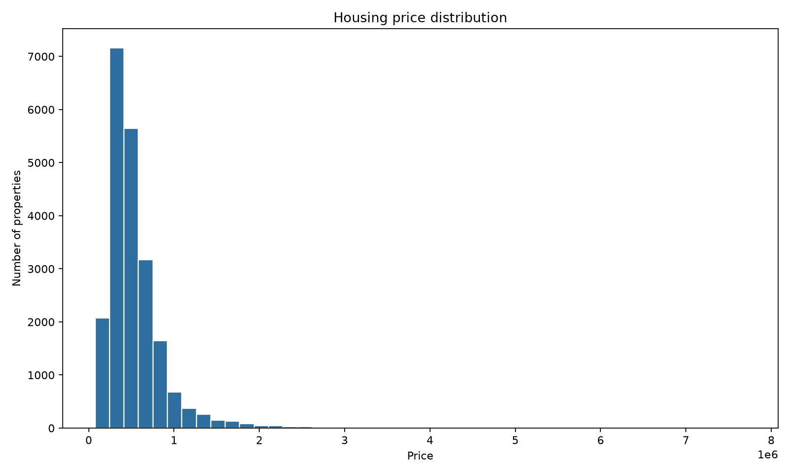
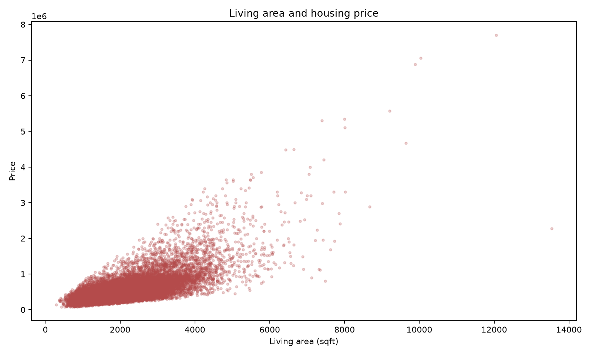

# ZHENG ZIYAO — Data Science Portfolio

I am a CISC7204 student building reproducible, evidence-led data analysis projects in Python. My current focus is turning a notebook workflow into clear questions, transparent preprocessing, visual evidence, and limitations that a reader can verify.

## Featured project

**Housing price analysis** — an exploratory and baseline modelling study using the CISC7204 Assignment 01 housing dataset. Living area and location/income-related variables show the clearest visible association with the target in the current analysis.

[Open the project repository](https://github.com/CheangChiIo/data-science-project)

## Key takeaway

**Key takeaway:** The exploratory plots suggest that living area and location/income-related variables are the most useful starting points for explaining the target price in this dataset; this is an association, not a causal claim.

## Visual evidence

*Figure 1. Distribution of the target house-price measure.*

*Figure 2. Association between living area and the target house-price measure.*

## Skills

Python, pandas, NumPy, Matplotlib, scikit-learn, data cleaning, exploratory visualisation, and notebook-based reproducibility.

## Publication status

This portfolio is published through GitHub Pages and links to the public project repository.
