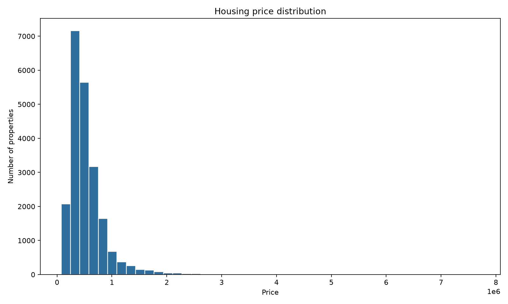
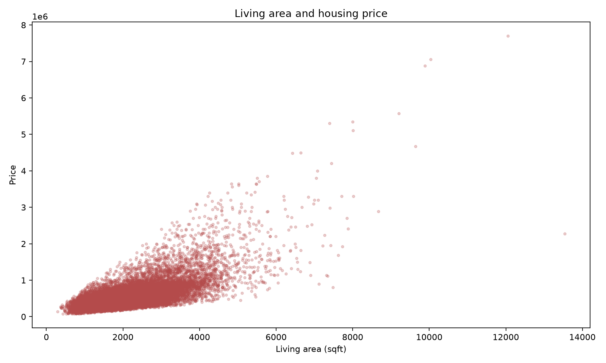

# ZHENG ZIYAO — Data Science Portfolio

I am a CISC7204 student developing reproducible data analysis and visualisation skills in Python. This portfolio connects a research question, a documented Notebook, visual evidence and limitations that readers can inspect.

## Featured project: Housing price analysis

**Research question:** How well do housing attributes explain sale prices in the supplied King County housing dataset?

**Status:** Completed coursework analysis and published portfolio; further validation is planned.

[Open the project repository](https://github.com/CheangChiIo/data-science-project)

## Key takeaway

**Living area has a clear positive association with sale price in this dataset.** The Notebook also compares multiple housing attributes and regularised models. These associations do not establish causation.

## Visual evidence

*Figure 1. Distribution of recorded sale prices, in USD. The long upper tail motivates careful evaluation of errors on expensive homes.*

*Figure 2. Living area (square feet) against sale price (USD). Larger homes tend to sell for more, while substantial dispersion remains at a given size.*

## Findings and limitations

The single-feature living-area regression has an in-sample R² of approximately 0.493. In the course split, the Ridge model has test R² of approximately 0.648 and the polynomial Ridge model approximately 0.700. The repository Notebook contains the corresponding code and outputs.

The sales are from 2014–2015 in King County, so the results do not represent current prices or other cities. The course workflow fills missing values before splitting and uses a random split; these are limitations of the present validation. My next step is to split before fitting preprocessing, then assess time-based performance and errors across price ranges.

## Skills

Python, pandas, NumPy, Matplotlib, seaborn, scikit-learn, data cleaning, exploratory visualisation and reproducible Notebooks.

## Feedback and improvement

Feedback supplied during the coursework recommended a prominent key takeaway and a clearer living-area chart caption. Both are included above. This revision also makes the research question, status and limitations explicit; its commit is identified in my Moodle registration.

## Sources and publication

The project uses the IBM Skills Network course version of the King County house-sales data. The project README records the source, usage notes, dependencies and run instructions.

This website is published through GitHub Pages. AI tools assisted preparation of code and written material; I remain responsible for the submitted content.
